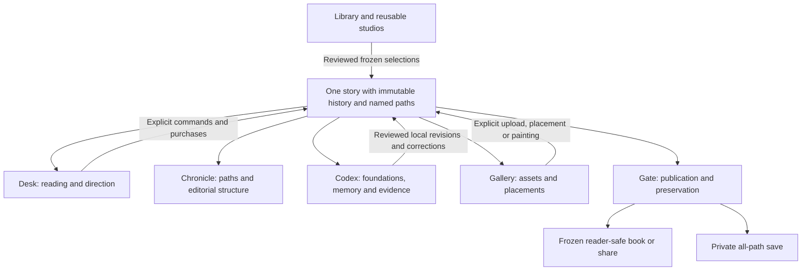

# Ink Morrow — product recovery proposal

Prepared 25 October 2026 from four specialist AI reviews: architecture, UI/usability, behavioral design, and fiction/narration. This is a proposal for the stakeholder, not an implemented release. Application source remains unchanged.

**Recommendation**

Build a substantial recovery release that restores Version 4's Scriptorium, creative depth and complete working journeys around Version 5's playable-story model.

The product promise should be: **Read a living story, shape it as deeply as you wish, and turn it into a work worth keeping.** Following the cast should be immediately usable. Rich worldbuilding, narrative craft, evidence, art, listening and publication should be available in coherent, visible places.

Version 5's reader-director idea does not require removing creative authority, long-form structure or mature tools. The recovery should preserve outside-cast play, optional Inhabit, meaningful alternatives, independent play styles, local recaps, explicit corrections and dependable spending/history safeguards.

The architectural recommendation is one application, one story authority and several useful workspaces. Retained Version 4 components offer substantial reusable work. Their old runtime also contains automatic purchases and a separate manuscript/Play authority, so restoration needs adapters to the current story model.

**Evidence and review limits**

Reviewers inspected current and retained implementation, historical product/design contracts and existing screenshots. The current main source is the September catalogue-studio restoration, already studied in [the project reference](PROJECT-NOTES.md). No new live app session, user study or paid provider comparison was conducted. Existing screenshots are visual references, not proof that every retained layout was successful or a specification to copy literally.

Two narrative checks were independently reproduced locally using pure functions, without a database or provider: an intention-only quotation was accepted as a goal-resolution effect; and three active commitments caused repeated commitment-pattern selection in reflective play. These establish narrow implementation weaknesses, not the behavior of every model or every generated story.

**What went wrong**

| Lens | Source-grounded diagnosis | Recovery consequence |
|---|---|---|
| Architecture | Stronger branch/request integrity was accompanied by loss of structural, evidence and management surfaces. | Keep the current authority; restore the missing capabilities against it. |
| UI | A stable workspace became a reader with an overloaded “Cast & story” disclosure. | Restore meaningful destinations and contextual panels; prioritize prose and tablet use. |
| Behavior | The power user's ability to inspect, shape, repair and finish work became less visible and less complete. | Make creative authority and action scope understandable, while preserving easy reading. |
| Fiction | Short-turn defaults, reduced craft control and thinner context encourage passage-by-passage narration. | Restore scene continuity, variable length, perspective, richer memory and deliberate narrative craft. |

The older accepted product description explicitly served a demanding reader moving into authorship. Version 5 removed much of the interface that supported that person. A simpler default journey should be achieved through better organization and optional depth.

Specific losses and weaknesses:

- References, cast, facts, corrections, costs, challenges, paths, episodes, illustrations, exports and saves are combined inside one disclosure above the prose. Its label advertises only part of the content.
- A pending generation disables ordinary page navigation, memory, recap and evidence inspection.
- Continue ignores an entered direction; the separate submit control remains “Send direction” for several different kinds of contribution.
- Leaving and reopening a story resets its reading position to the latest passage. Direction drafts are held only in browser memory.
- Earlier prose is displayed beside current-head facts and control state. The action destination and the reading position are different, with insufficient structural separation.
- Exact effect quotations are checked, then discarded from persisted changes. Evidence opens a whole passage rather than the retained exact quotation available in the older Codex.
- The current narrative target is roughly 120–220 words, or 80–140 when brisk. Reflective pacing has no independent length control. These are prompt targets, not hard word limits.
- Recent context uses twelve history records clipped to their last 1,500 characters. Clarifications and local actions can occupy those slots. Story-local reference/craft editing, scene circumstances and perspective are comparatively thin.
- Episodes currently become chapters in a single-volume publication. Play framing, scene continuity and editorial organization need separate concepts.

Sources: [old product constitution](../../../docs/releases/4.0.0/WORKSHOP-DECISIONS.md), [current layout](../../../frontend/index.html), [current reader](../../../frontend/app/fiction/app.js), [effect persistence](../../../backend/src/modules/fiction/model.js), [story context](../../../backend/src/modules/fiction/service.js), [publication projection](../../../backend/src/modules/fiction/publication.js).

**Restoration inventory**

| Area | Already present in Version 5 | Recovery scope |
|---|---|---|
| Story participation | Follow, scoped Steer, Ask, optional Inhabit | Clearer controls, action labels and destination; keep all four experiences. |
| Library | Story shelf, reusable worlds/characters/Scribes, branded studios | Strong resume context, richer collection organization and direct studio-to-story handoff. |
| Reference creation | Editable AI development, local saving, portraits, frozen copies | Full-height studios, field comparison/adoption, durable drafts and ongoing story-local revisions. |
| Reading | Single-passage display, Previous/Next/Latest | Independent bookmarks, stable passage identity, quiet layout and browsing during generation. |
| Structure | Immutable moments, paths, episodes | Bounded Chronicle, scene groupings and optional chapters/volumes. |
| Memory | Public facts, recall, evidence links, corrections | Categorized Codex, quoted provenance, reference-versus-event clarity, explicit owner planning view. |
| Art | Covers, reference portraits, passage illustrations, upload/painting | Collection-first Gallery, visual passage targeting, placements, unplaced assets and deliberate reference use. |
| Audio | Retained helpers only; no current listening surface | Read-aloud, cached replay, controlled auto-read and selected-path audiobooks. |
| Publishing | Nine formats and normalized publication adapters | Metadata, contents/art preview, front/back matter, useful export management and revocable reading snapshots. |
| Preservation | Private all-path playable saves | Reusable-reference portability, installation recovery guidance and separately scoped legacy conversion. |
| Settings | Provider roles, credentials, text size, story preferences | Grouped device/story/provider settings, craft/length controls, model capability and price information, audio settings. |

Restored catalogues, pagination, uploads and nine-format exports must not be misreported as absent. The recovery should connect and deepen them.

**The target workspace**

Global **Library** contains Stories, Worlds, Characters, Scribes and a Bookshelf collection. Settings and Lock remain utilities. Selecting a story enters a stable workspace with its title, selected path and role visible.

| Room | Plain purpose | Useful content |
|---|---|---|
| **Desk — Read & direct** | Experience and influence this story | Passage, illustration, reading controls, Continue, Steer, Ask, optional Inhabit, brief changes and listening. |
| **Chronicle — Paths & structure** | Understand where you are and what can change | Accessible episode/scene outline, passage excerpts, branch ancestry, bookmarks and editorial organization. |
| **Codex — People, world & memory** | Inspect intent, truth and evidence | Story-local foundations, cast, Scribe craft, goals, commitments, relationships, remembered facts and corrections. |
| **Gallery — Art & media** | Manage the story's visual and audio material | Covers, portraits, passage art, unplaced assets, placement review, uploads, painting and listening artifacts. |
| **Gate — Books, saves & sharing** | Preserve and finish the work | Reader-safe book preview/export, private playable save, reusable-reference portability and implemented sharing. |

Each room owns a full useful workflow. Desk shortcuts may open the relevant inspector or room while preserving the reading anchor. They should not create another independent copy of that workflow.

On portrait Android tablet, use a compact header, a generous reading area, a small reachable action strip and labelled bottom navigation with reserved space. An active composer must resize with the keyboard. On landscape tablet, use a navigation rail and an optional reference drawer; the prose should not be squeezed into a three-column desktop layout. Desktop can add a collapsible context inspector beside a restrained prose column.

Restore the existing gothic visual language: the canonical lockup, distinct Scribes, environmental artwork at thresholds and collections, plum/ink/wine surfaces, gold guidance, quiet vellum, Cormorant display type, Literata reading type and clear interface labels. Keep large covers on shelves and overviews. Avoid recreating duplicated navigation, oversized headers or ornamental controls from every old screenshot.

Sources: [accepted tablet UX](../../../docs/releases/4.0.0/UX-ARCHITECTURE.md), [art direction](../../../docs/releases/4.0.0/ART-DIRECTION.md), [retained shell](../../../frontend/styles/shell.css), [current studios](../../../frontend/app/fiction/library.js).

**How interaction should change**

The reading position, the selected path and the moment where new work will occur need independent identities. Historical reading should offer **Return to latest** and **Explore from this moment**. An inspector should clearly show whether it describes the selected passage or the latest head. Generating from an old displayed passage must not silently target an unseen future.

An empty composer offers Continue. Entered Steer text changes the primary action to **Generate from this direction**. Ask is labelled **Ask outside the story**; character contributions name the inhabited person. Persistent focus and this-moment direction remain distinct. Outside-story answers belong in a separate response surface and history category, rather than becoming ordinary numbered narrative pages.

Already-saved reading, public memory and evidence remain usable while a purchase runs. Conflicting mutations remain guarded. Returning to the reader restores its cursor, scroll anchor and draft; a completed passage can announce that it is ready instead of forcibly moving the reader.

Wrong remembered state, an unwanted story development, poor prose and a provider failure need different repair actions. Corrections are local application commands. Alternatives preserve the original future. A refusal by a fictional character must never prevent the owner using application controls.

Paid actions keep a compact operation/data/call summary visible even after remembered consent. Remembered authority should be scoped to the operation and reviewed provider/model/data/call plan, with a reset control. Progress names real stages, preserves input and distinguishes known charges from unknown cost. Leaving a view must not imply that a dispatched request was cancelled or refunded.

**Recover the fiction craft**

Passage length, scene pacing and screen pagination should be separate. Offer brief/developed/extended narration and an advanced approximate word target. Allow a conversation or scene to span several durable passages. Preserve the option to stop before a decision owned by an inhabited character.

Restore explicit perspective, tense, language, tonal intent and narrative distance. Permit a focal character or ensemble emphasis independently of avatar ownership. A protagonist need not be the player. Keep genre suggestions open to mixed and custom stories instead of making a small preset list the creative ceiling.

Compile an inspectable narrative contract: binding truth and ownership; the current request and scope; current scene circumstances; story-local creative choices; the frozen Scribe's soft craft preferences; and provisional scene suggestions. Important distinctions include diction, rhythm, dialogue, description, plot movement, tension and aftermath. The existing Scribe vocabulary can support this without creating separate autonomous characters or new background models.

Separate recent fiction from Ask and local history entries. Reserve bounded context for the current scene, relevant cast, unresolved commitments, important completed events and older evidence. Preserve fixed hidden truth, reader discoveries, each character's knowledge and future intentions as separate concepts. The current ancestry graph remains authoritative; rebuildable indexes/checkpoints can improve long-work performance when measurements show the need.

Improve scene scheduling so promises do not monopolize Follow. Record proposed patterns separately from what actually occurred. A quiet passage is valid with no durable change. An episode can offer a satisfying vignette or open ending without requiring a goal flag to certify literary payoff.

Strengthen outcome-versus-intention checks and adversarial fixtures. The reproduced goal-resolution case is a reason for better typing, validation and model evaluation. Exact quotation matching alone cannot prove semantic entailment. Optional reviewers cannot recover context that was never supplied or guarantee literary quality. Context and whole-scene evaluation should improve before adding more calls.

Sources: [older craft prompt](../../../backend/src/prompt.js), [retained scene metadata](../../../backend/src/modules/stories/scenes.js), [current context](../../../backend/src/modules/fiction/service.js), [director](../../../backend/src/modules/fiction/director.js), [episode model](../../../backend/src/modules/fiction/episodes.js).

**One authority, several working surfaces**

Scenes describe fictional circumstances. Episodes describe play focus and stopping. Chapters/volumes describe editorial organization. They may align, but should not be forced to be the same thing. Structure groups stable passage identities and does not duplicate prose or rewrite chronology.

Future fact changes should retain source type, exact quote and immutable source identity. Old records without quotations remain labelled at passage level. Story-local reference changes need previewed field differences and immutable revisions. Catalogue edits remain independent from established stories. Reader-safe Codex views remain separate from explicitly opened owner planning views that contain spoilers.

Media and publications attach to exact selected content. Audio caching should follow text/model/voice identity, while audiobook jobs use a frozen selected-path projection and a reviewed purchase ceiling. Reuse synthesis helpers selectively; their recursive retry behavior needs adaptation. Sharing should expose immutable reader-safe snapshots with revocation. No placeholder should pretend a restoration is already available.

Current storage identity checks remain. New structure, reference revisions and provenance need transactional migrations plus save validation/import compatibility. Existing Version 5 saves and originals must be protected. Any Version 4 conversion should read an untouched source into a separate new copy with a preview and an honest unsupported-content report; it must not weaken database-family checks.

Sources: [current authority](../../../backend/src/modules/fiction/store.js), [legacy automatic runtime](../../../backend/src/legacy-runtime.js), [legacy successor work](../../../backend/src/modules/writing/transactions.js), [strict save model](../../../backend/src/modules/fiction/saves.js), [audio helpers](../../../backend/src/modules/audio/narration.js).

**Two prior decisions to reopen explicitly**

The strongest shared recommendation is to restore creative depth without making writing or lore administration a prerequisite to reading.

I also recommend **optional editorial intervention**. An owner should have a direct way to repair a sentence, improve the telling or develop a local reference. This deliberately revisits Version 5's earlier blanket exclusion of manual prose editing. It needs a designed boundary: wording revisions preserve the original evidence; event-changing historical revisions create an alternative path; any prose/state divergence is visible. A compulsory from-scratch writing mode is not required for this recovery.

Legacy project conversion is a separate scope decision. Reusable-reference portability and installation backups are useful immediately; faithful old-manuscript conversion needs its own preview, mapping and acceptance work. It should not become an excuse to delay the core experience indefinitely.

**Delivery sequence**

1. **Agree the recovered product through a realistic tablet prototype.** Use a populated story, rich cast, artwork, long history and an alternative path. Show Desk, Chronicle, Codex, Gallery and Gate, including keyboard-open, waiting and failure states. Review the visual direction and principal journeys with the stakeholder before broad implementation. Produce a preservation matrix so each valued old capability has a recorded disposition.
2. **Restore orientation and dependable reading.** Deliver the adaptive shell, saved reading position, stable passage navigation, clear action destination, contextual contribution labels, preserved drafts and free inspection during generation. Introduce bounded read models and precise future provenance. Rooms must be delivered as usable workflows rather than vacant tabs.
3. **Restore creative and narrative depth.** Deliver story-local world/cast/Scribe revisions, categorized evidence and correction, perspective/length/craft controls, scene context and optional editorial structure. Pair the interface with the actual context compiler and state/save changes. Address the reproduced planner/validation weaknesses.
4. **Restore the complete art, listening and finishing journey.** Deliver the Gallery collection and placement review, explicit listening/audiobooks, publication preparation/preview, saves and reference portability. Adapt immutable sharing and deeper recovery in coherent follow-on slices. Restore optional solo tools only where they serve the chosen play style, recording results in the same path history.
5. **Qualify the recovered product as a whole.** Preserve CI, security, accounting, documentation and save round-trip checks. Add populated visual review and real-tablet task acceptance. Measure substantial long-form fixtures and assess complete scene sequences, rather than counting features or passing only individual mocked passages.

No calendar estimate is asserted before the first prototype and capability matrix establish the exact scope. This is substantial product recovery, with reuse of proven components and focused replacement of inadequate flows.

**Acceptance is about creative work**

| Journey | Required outcome |
|---|---|
| Start and follow | Begin and enjoy a story without an avatar, a long setup wizard or opening advanced tools. |
| Build and revise | Create rich references, use them in a story, revise selected local fields, and understand what applies where. |
| Read and return | Navigate a long work and leave/reopen any tool without losing the reading position or direction. |
| Inspect and repair | Find a relationship or remembered fact, inspect its evidence, correct the record, and return to the same passage. |
| Explore an alternative | Identify the fork point, preserve the original future, and restore the correct knowledge/control/preferences. |
| Wait and recover | Browse saved work during delayed AI; cancellation/failure/staleness never causes duplicate purchases or a lost draft. |
| Illustrate and listen | Upload or review a painting, see its placement, listen to selected text and replay cached audio without accidental new synthesis. |
| Finish and preserve | Preview a coherent book with intended art and metadata; separately export/import a private all-path save. |

Critical visual/task profiles are portrait and landscape Android tablet with keyboard open, enlarged text, touch input and reduced motion, plus desktop keyboard operation. The stakeholder should be able to locate memory, paths, art and export through stable navigation without a manual.

Mechanical fixtures must cover save-copy, ancestry/privacy, interrupted and late work, quote provenance, changes of reference/context, spending ceilings, cached media and substantial multi-path stories. Narrative evaluation should use the two curated openings plus a longer ensemble: consistent discoveries, distinct voices, justified refusal and cooperation, a believable quiet scene, meaningful aftermath and a satisfying stopping point. Paid live evaluation requires its own explicit authorization and should record model/settings, latency and spend alongside blinded judgments.

The recovery is successful when the stakeholder can carry a substantial creative work through these journeys on the tablet and recognizes Ink Morrow's identity and depth again. Automated correctness remains necessary; it does not by itself establish that the product is good to use or good at fiction.
